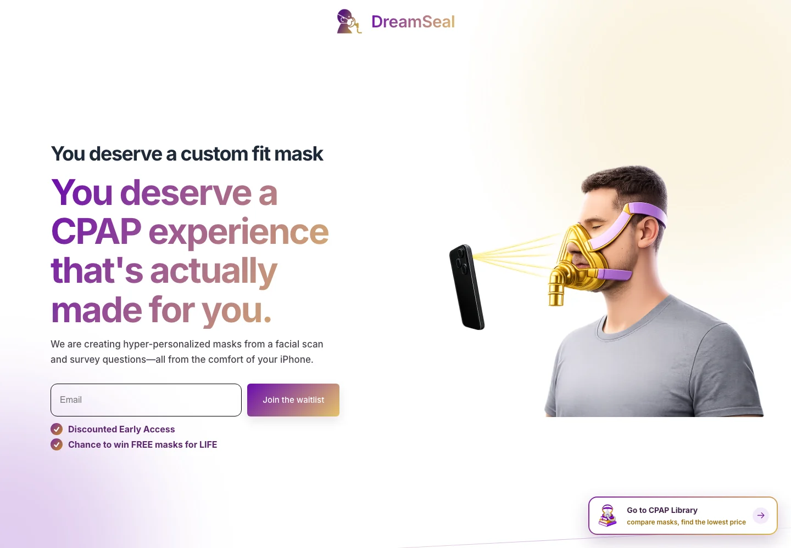
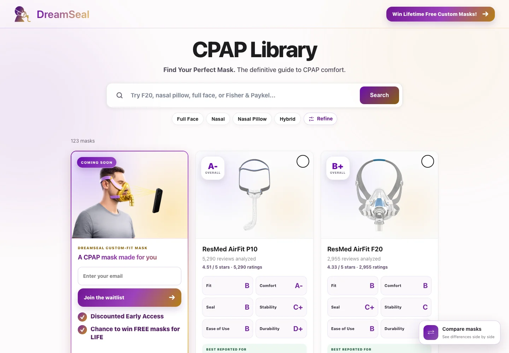
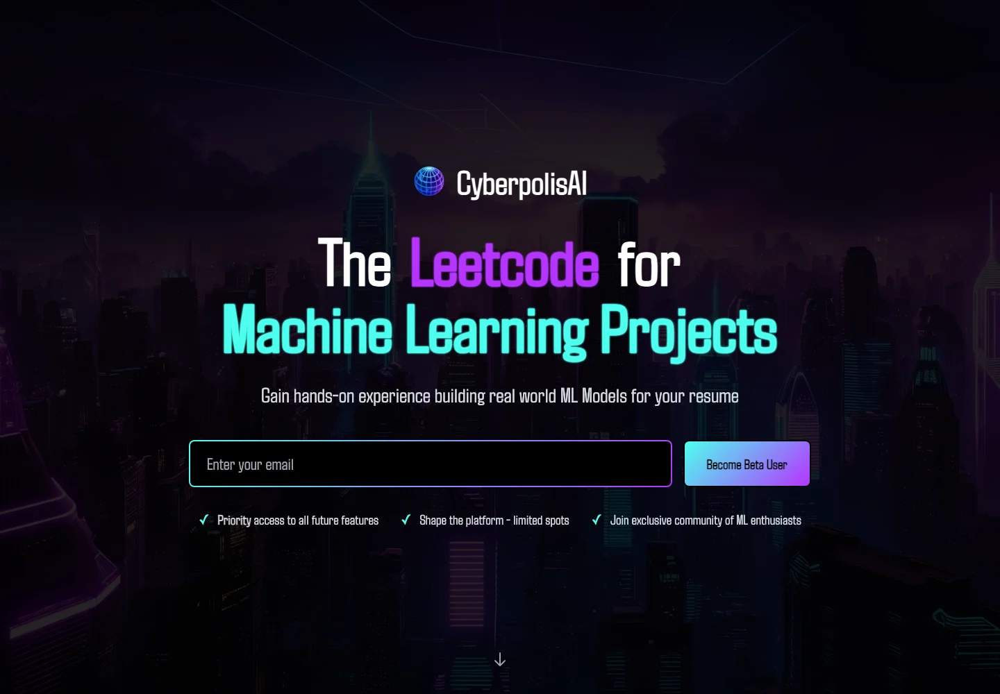
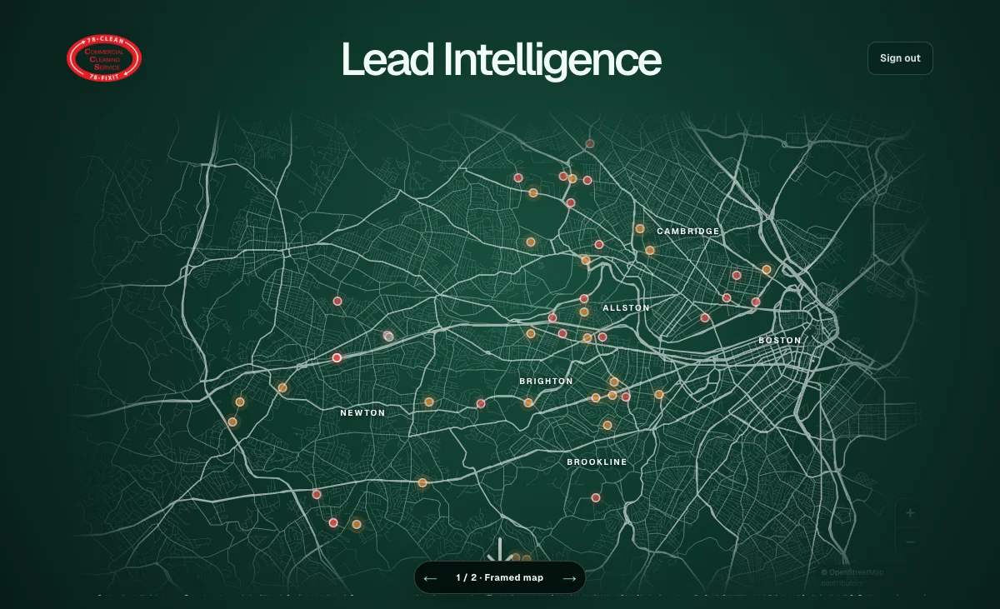

<!-- Hallmark · pre-emit critique: P5 H5 E5 S5 R5 V4 -->

## Selected work

<table>
  <tr>
    <td width="50%" valign="top">
      
        
      <strong><a href="https://www.dreamseals.com/">DreamSeal ↗</a></strong>
      
An end-to-end custom CPAP experience that turns an iPhone facial scan and sleep preferences into personalized mask options.

      
<code>Computer Vision</code> <code>iPhone LiDAR</code> <code>Angular</code> <code>Firebase</code>

    </td>
    <td width="50%" valign="top">
      
        
      <strong><a href="https://thecpaplibrary.com/">The CPAP Library ↗</a></strong>
      
A searchable comparison engine that turns product data and user reviews into clear mask grades for fit, comfort, seal, and durability.

      
<code>Data Modeling</code> <code>Search UX</code> <code>TypeScript</code> <code>Angular</code>

    </td>
  </tr>
  <tr>
    <td width="50%" valign="top">
      
        
      <strong><a href="https://cyberpolisai.com/">Cyberpolis AI ↗</a></strong>
      
An interactive learning platform where students build real-world machine-learning projects through guided lessons and hands-on modules.

      
<code>Machine Learning</code> <code>Interactive Learning</code> <code>TypeScript</code> <code>Angular</code>

    </td>
    <td width="50%" valign="top">
      
        
      <strong><a href="https://intelligence.cleanleads.workers.dev/">Janitorial Sales Intelligence ↗</a></strong>
      
A property-level system that maps Greater Boston opportunities, identifies likely buyers, ranks leads, and prepares targeted outreach.

      
<code>Next.js</code> <code>TypeScript</code> <code>Leaflet</code> <code>Sales Intelligence</code>

      
Private Boston demo · access available on request

    </td>
  </tr>
</table>
